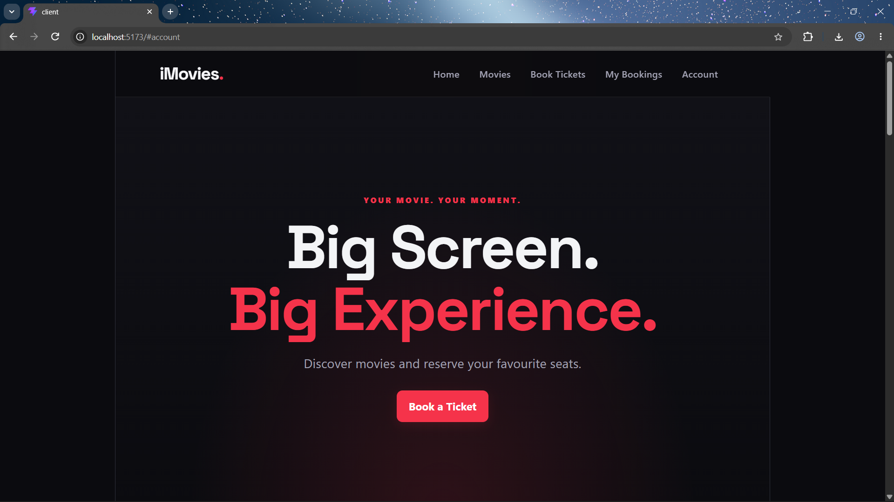
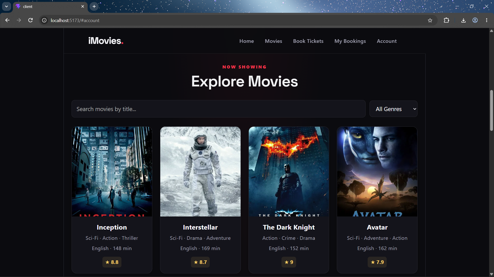
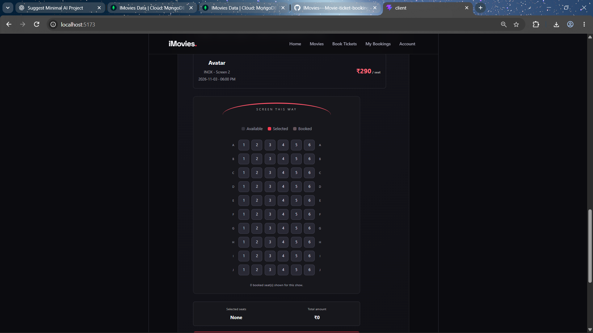
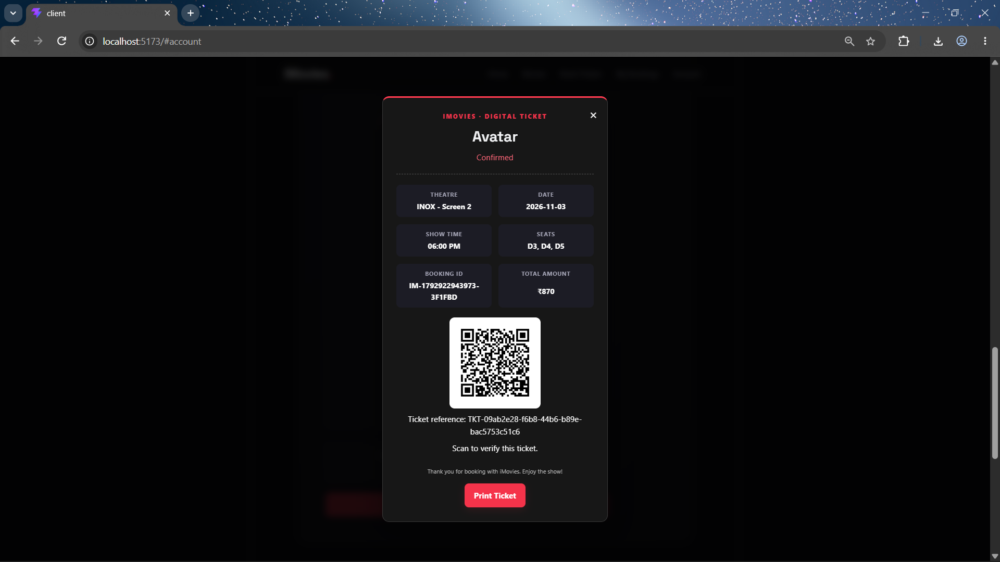

# iMovies — Movie Ticket Booking Made Simple

iMovies is a full-stack movie ticket booking web application built with React and Vite on the frontend, Node.js and Express on the backend, and MongoDB with Mongoose for data storage. It demonstrates the main flow of browsing movies, viewing showtimes, selecting seats, making a demo booking, and viewing ticket details.

> **Project status:** Academic/demo application. The checkout is simulated and is not connected to a real payment provider.

## Features

### Customer features
- Register, log in, and authenticate using a JWT-based flow.
- Browse movies and view poster, description, genre, language, duration, release date, and rating.
- Find shows with theatre, date, time, and ticket price.
- Select seats and submit a booking through the demo checkout.
- View booking history and ticket details.
- View a QR code for a ticket and open the ticket-verification endpoint.
- Cancel an eligible booking through the application's demo cancellation flow.

### Admin features
- Access admin functionality through role-based authorization.
- Manage movie and show data.
- View booking information through the admin dashboard.

The exact options visible in the UI depend on the current application code and the signed-in user's role.

## Screenshots

### Home Page


### Explore Movies


### Seat Selection


### Digital Ticket


### Admin Dashboard


## Technology stack

| Area | Technology |
|---|---|
| Frontend | React, Vite, JavaScript, CSS |
| Backend | Node.js, Express |
| Database | MongoDB Atlas, Mongoose |
| Authentication | JSON Web Tokens (JWT), password hashing in the authentication flow |
| API | REST endpoints |
| Ticket features | QR code generation and ticket-verification endpoint |

## Project structure

```text
IMovies/
├── client/                 # React + Vite frontend
│   ├── public/
│   └── src/
├── server/                 # Express backend
│   ├── models/
│   ├── routes/
│   ├── middleware/
│   └── server.js
├── docs/
│   ├── architecture.md
│   ├── er-diagram.md
│   └── user-flow.md
├── .gitignore
└── README.md
```

Your actual project may contain additional files or use slightly different subfolder names. Keep the existing working structure rather than moving files solely to match this illustration.

## Prerequisites

- Node.js and npm installed.
- A MongoDB database, such as a MongoDB Atlas cluster.
- Git (for version control).
- A modern browser.

## Setup

### 1. Clone the repository

```bash
git clone https://github.com/YOUR_USERNAME/imovies.git
cd imovies
```

Replace `YOUR_USERNAME` with the GitHub account that owns the repository.

### 2. Configure the backend

```bash
cd server
npm install
```

Create a `.env` file inside `server/` with the environment variables used by your backend:

```dotenv
PORT=5000
MONGO_URI=your_mongodb_connection_string
JWT_SECRET=replace_with_a_long_random_secret
CLIENT_URL=http://localhost:5173
SERVER_PUBLIC_URL=http://localhost:5000
```

Use the variable names your code actually reads. `CLIENT_URL` and `SERVER_PUBLIC_URL` may be optional depending on the route configuration. Never commit real values or share your actual MongoDB URI or JWT secret.

Start the backend using the script defined in `server/package.json`. For example:

```bash
npm run dev
```

If no development script exists, use the start command configured by your project; a simple project may use `node server.js`.

### 3. Configure the frontend

Open a second terminal:

```bash
cd client
npm install
```

Start the Vite development server using the script in `client/package.json`:

```bash
npm run dev
```

Open the local URL printed by Vite, commonly `http://localhost:5173`.

If the frontend uses an API base URL environment variable, configure it according to the variable name read in `client/src/api.js`. Do not assume a variable name without checking that file.

## API route groups

The backend has been organized around these route prefixes:

| Prefix | Purpose |
|---|---|
| `/api/auth` | Registration and authentication |
| `/api/movies` | Movie data |
| `/api/shows` | Show data |
| `/api/bookings` | Booking, checkout, and cancellation flows |
| `/api/admin` | Admin operations |
| `/api/tickets` | Ticket QR and verification routes, if mounted in `server.js` |

The exact methods and request/response schemas should be checked in the route files.

## Environment variables

| Variable | Purpose | Secret? |
|---|---|---|
| `PORT` | Port used by the Express server | No |
| `MONGO_URI` | MongoDB connection string | **Yes** |
| `JWT_SECRET` | Secret used to sign/verify JWTs | **Yes** |
| `CLIENT_URL` | Frontend origin, for example when configuring CORS | Usually no |
| `SERVER_PUBLIC_URL` | Base URL used when constructing public ticket-verification URLs | Usually no |

Only document variable names and example placeholders in this README. Keep actual values in a local `.env` file and ensure `.env` is ignored by Git. If the project uses additional frontend environment variables, document their names after checking the client code.

## Data model overview

- **User:** name, email, password hash, role (`user` or `admin`).
- **Movie:** title, description, genres, duration, language, release date, poster URL, rating.
- **Show:** movie reference, theatre name, date, time, ticket price, total seats, booked seats.
- **Booking:** booking identifier, user email, show reference, selected seats, total amount, booking status, and relevant ticket/payment fields.

See [`docs/er-diagram.md`](docs/er-diagram.md) for the relationship diagram. Field names may evolve as the schema changes.

## Documentation

- [System architecture](docs/architecture.md)
- [Entity relationship diagram](docs/er-diagram.md)
- [User and admin flow](docs/user-flow.md)

The diagrams use Mermaid syntax. GitHub can render Mermaid diagrams directly in Markdown.

## Testing checklist

- [ ] Backend starts and connects to MongoDB.
- [ ] Frontend starts and loads movie data.
- [ ] Registration, login, and logout work.
- [ ] Movie details and showtimes are displayed correctly.
- [ ] Seat selection prevents selection of unavailable seats.
- [ ] Demo checkout creates a booking.
- [ ] Booking history and ticket details load.
- [ ] QR/ticket verification works as intended.
- [ ] Cancellation updates the booking and seat availability as intended.
- [ ] Admin-only routes reject non-admin users.
- [ ] `.env` and other secrets are not tracked by Git.

## Known limitations and security notes

- **Payments are simulated.** The application does not establish that money was actually collected. Do not present the demo checkout as a real payment integration.
- **Refunds are simulated.** A booking status update is not the same as issuing a refund through a payment provider.
- **Concurrency needs production hardening.** Seat reservation and cancellation should use atomic database operations or transactions to prevent two users from booking the same seat simultaneously.
- **Ticket verification is a demo feature.** A production implementation should use unguessable ticket tokens, rate limiting, appropriate privacy controls, and clear rules for cancelled tickets.
- **Production deployment requires additional hardening.** Use HTTPS, secure cookie/token handling, input validation, rate limiting, logging, and server-side authorization checks.
- Movie posters and sample show data depend on external URLs and seeded database records.

## License

Add a license if you intend to distribute or reuse this project publicly. Until one is added, no open-source license is implied.
